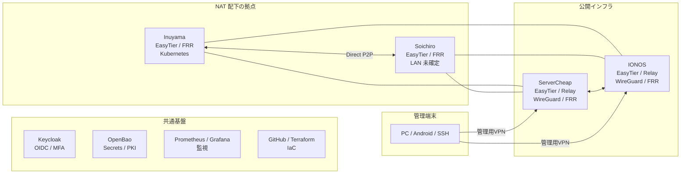

# kigawa-net 全体ネットワーク・VPN基盤設計 v1.0

基本方針：EasyTier を NAT Traversal と拠点間 P2P の基盤とし、ServerCheap・IONOS を公開中継ノードとして冗長化します。既存の WireGuard + FRR/BGP は移行期間中維持し、Keycloak・OpenBao・Kubernetes・管理端末を含めて統合します。

今回の設計では、alice は廃止対象、ServerCheap は新設対象とします。

> これは目標アーキテクチャであり、ServerCheap 移行や EasyTier 導入が既に完了していることを意味しません。既存の WireGuard・FRR・Kubernetes・CI/CD を保護しながら段階移行する設計です。

## 1. 全体アーキテクチャ



拠点間のデータプレーンを EasyTier で統一する方向とします。管理端末は EasyTier クライアントを使用する案と、Headscale を併用する案の両方を残します。運用の単純さを優先するなら EasyTier 統一、Keycloak OIDC と端末単位 ACL を重視するなら Headscale 併用が適します。

## 2. 各拠点の役割

| 拠点 | 接続条件 | 役割 | HA方針 |
| --- | --- | --- | --- |
| ServerCheap | 公開IP想定 | EasyTier公開Peer、Relay、WireGuard、FRR | IONOSで代替 |
| IONOS | 公開IP | EasyTier公開Peer、Relay、WireGuard、FRR | ServerCheapで代替 |
| Inuyama | NAT配下 | Kubernetes、FRR、EasyTier、主要サービス | 公開2拠点へ接続 |
| Soichiro | 通常NAT | EasyTier、FRR、将来のLAN接続 | 公開2拠点へ接続 |
| 管理端末 | 任意のNAT | VPN経由のSSH・管理アクセス | 公開2拠点を利用 |

ServerCheap・IONOS は、できるだけアプリケーションや認証基盤の本体を配置せず、軽量なネットワーク中継・障害時アクセス用ノードとして運用します。

## 3. ネットワーク分離

| ネットワーク | CIDR案 | 用途 |
| --- | --- | --- |
| Inuyama LAN | `10.0.0.0/24` | 既存サーバー |
| Inuyama管理LAN | `192.168.1.0/24` | 既存管理ネットワーク |
| Soichiro LAN | 未確定 | 将来の拠点LAN |
| EasyTier Overlay | `10.250.0.0/24` | P2P・Relay |
| 既存WireGuard | `172.31.254.0/24` | IONOS側 |
| 旧alice WireGuard | `172.31.255.0/24` | ServerCheapへ移行検討 |
| P2P試験用 | `172.31.253.0/30` | 独立試験 |
| Kubernetes Pod | `10.244.0.0/16` | 既存Flannel |
| Kubernetes Service | `10.96.0.0/12` | 既存Service |

注意：`10.250.0.0/24` は既存の Kubernetes Service CIDR `10.96.0.0/12` の範囲外ですが、将来のネットワークとの重複確認は必要です。

Soichiro の LAN CIDR が決まるまでは、Overlay IP 同士の通信のみを有効にします。

## 4. VPN・ルーティングの詳細設計

### 4.1 EasyTier：拠点間P2PとNAT越え

EasyTier の役割は次の3つです。

1. NAT配下のノードを相互発見する。
2. UDP Hole Punching による直接 P2P を試行する。
3. 直接接続できない場合に公開ノード経由で Relay する。

初期 Overlay アドレス案：

| ノード | Overlay IP |
| --- | --- |
| ServerCheap | `10.250.0.1` |
| IONOS | `10.250.0.2` |
| Inuyama Gateway(k8s4) | `10.250.0.11` |
| Inuyama control-plane(k8s1) | `10.250.0.12` |
| Inuyama control-plane(k8s2) | `10.250.0.13` |
| Soichiro Gateway | `10.250.0.21` |

### 4.1.1 実機での確認状況

| 日付 | 確認内容 | 結果 |
| --- | --- | --- |
| 2026-10-28 | ionos(`10.250.0.2`)と bao-02 / ServerCheap(`10.250.0.1`)に EasyTier v2.6.4 を導入(#351・#357・#361) | 両ノードで `easytier.service` が `active`。ufw で 11010/tcp・udp を許可 |
| 2026-10-28 | 公開 Peer 2 台の相互接続(`easytier-cli peer`) | p2p(tcp)で直接接続。遅延 11.63ms、パケットロス 0.0% |
| 2026-10-28 | Overlay からの受信の絞り込み(ufw、#368・#369)。ionos・bao-02 で、Overlay(`10.250.0.0/24`)の送信元を拒否し、許可リストだけを通す | ionos: `DENY IN 10.250.0.0/24` が先頭(許可リストは空)。bao-02: Raft 用の 8200/8201 の allow が deny より前にある。適用後も 3 台が p2p で接続(遅延 11〜35ms、loss 0.0%)、`ping 10.250.0.2` は 3/3 で通る |
| 2026-10-28 | bao-03(`host-hye1`、`10.250.0.31`)の Overlay からの受信の絞り込み(#376・#377) | bao-03: 8201/tcp・8200/tcp の allow が `DENY IN 10.250.0.0/24` より前(1〜3 番)。`easytier` と `openbao` が `active`。bao-02(遅延 31.77ms)・ionos(同 34.13ms)に p2p で接続、loss 0.0%、`ping 10.250.0.1` は 3/3 |
| 2026-10-29 | Inuyama の control-plane 3 台(k8s4 `10.250.0.11`・k8s1 `10.250.0.12`・k8s2 `10.250.0.13`)に EasyTier v2.6.4 を導入(#391・#395・#399・#401・#405)。ufw のないホストなので、iptables の `EASYTIER-OVERLAY` チェーンで Overlay からの受信を絞る(`modules/overlay-firewall`) | 3 台とも `easytier` が `active`、公開 Peer 2 台・bao-03 に p2p で接続(loss 0.0%)。control-plane 同士は LAN の発見で 0.28〜0.44ms の直接接続。公開ノードとの遅延は 144〜185ms。bao-02 から 3 台の Overlay へ `ping` は通り、6443・10250・22 は遮断(対照の 127.0.0.1:22・74.208.55.86:22 は接続できた)。`kubectl get nodes` は全ノード `Ready`、k8s2 の MAAS のサービスも `active` |

- 設定ファイル(`/etc/easytier/easytier.toml`、`ipv4` / `dhcp` / `listeners` / `[network_identity]` / `[[peer]]`)の書式は、v2.6.4 で通ることを確認した。
- 同じ Overlay に、管理者が追加した別のノード(`host-hye1`、`10.250.0.31`)も参加している。
- Overlay からの受信は、送信元アドレス(`10.250.0.0/24`)で絞っている。インターフェース名で絞るには EasyTier の設定の変更と再起動が要り、メッシュが切れるため。ICMP は ufw の `before.rules` で許可されるので、ping は通る。許可は `easytier_overlay_allow`(既定は空。bao-02 だけ Raft 用に 8200/tcp・8201/tcp)で足し、足したルールは外しても自動では消えない(`ufw delete` が要る)。
- bao-02 から bao-03 の Overlay の IP(`bao-03.kigawa.net:8200`)へ、TLS・HTTP とも届くことを確認した。bao-03 は HTTP 503 `Vault is sealed` を返す。OpenBao が未初期化(`bao operator init` と Unseal が未実施。設計書 `docs/openbao-implementation-design.md` §6 のとおり、人間が端末で行う)のためで、ネットワークの異常ではない。このため、OpenBao の Raft のリーダー選出と、`easytier` の再起動が Raft に与える影響は、初期化が済むまで確認できない。
- control-plane への EasyTier の SSH 接続先は `var.server_ip`(`10.0.0.x`)にする。CI の実行環境は WireGuard 経由で `10.0.0.x` にだけ届き、`var.host`(`192.168.1.x`)には届かないため(#399)。
- 未確認: 公開 Peer 停止時の Relay 切替と Direct への復帰、Soichiro の接続(見送り中。Terraform のモジュールと LAN の範囲が未定)、OpenBao の Raft のリーダー選出(初期化後)。

### 4.1.2 Secure Mode への移行

Secure Mode の Terraform 対応は `hardware/modules/easytier` に実装済み。各 root module の `easytier_secure_mode_enabled` は既定で `false` とし、設定変更だけで稼働中 overlay を切断しない。Secure Mode は EasyTier 2.6.0 以降が必要で、現在固定している v2.6.4 は要件を満たす。

有効化前に、Terraform 管理下の 6 台(bao-03 `10.250.0.31` を含む)と追加参加端末を含む全 peer のバージョン・Secure Mode 対応を確認する。EasyTier の Secure Mode は新しい peer から旧 peer への接続互換性を保証しないため、部分適用を通常運用にしない。WireGuard の管理・OpenBao 経路を維持し、保守時間内に全 peer の設定を切り替え、`easytier-cli peer` と Overlay 疎通を確認する。異常時は `easytier_secure_mode_enabled=false` に戻して apply する。

#### 切替前の条件

1. OpenBao、Kubernetes、SSH の代替管理経路として WireGuard と現地コンソールを維持する。EasyTier 経由だけの管理接続で作業しない。
2. `easytier-cli peer` で現在の peer 一覧を保存し、`bao-02` / IONOS から全 Overlay IP への ping、OpenBao の 8200/8201、`kubectl get nodes` が正常な状態を記録する。
3. `bao-02`, IONOS, `bao-03`, `k8s4`, `k8s1`, `k8s2` と、Terraform 外の端末を含む全 peer が EasyTier v2.6.4 以上であることを確認する。非対応・所在不明の peer があれば切替を始めない。
4. 6 つの Terraform root すべてで `easytier_secure_mode_enabled=true` にした plan を作り、EasyTier 設定とサービス再起動以外の差分がないことを確認する。bao-02 の plan には `/etc/easytier/credentials.json` が加わることも確認する。Terraform 外の peer は別途 Secure Mode 設定を準備する。

#### 適用順序

EasyTier の移行ガイドに従い、legacy peer が接続できる Secure Mode 対応 peer を先に用意し、その後クライアント側を切り替える。Secure Mode を有効にしたクライアントは legacy peer に接続できないため、各段階で下記の確認が通らなければ次へ進まない。

1. **IONOS** を Secure Mode に切り替える。EasyTier peer が復帰し、IONOS から `bao-02` および既存 Overlay peer に接続できることを確認する。
2. **bao-02** を切り替える。IONOS との相互接続、Overlay 疎通、OpenBao Raft の 3 voter と leader 状態を確認する。
3. **bao-03** を切り替える。bao-02 / IONOS との peer 接続、OpenBao の 8200/8201、Raft 状態を確認する。
4. **k8s4** (Inuyama gateway) を切り替え、公開 peer 2 台への接続と `kubectl get nodes` の `Ready` を確認する。
5. **k8s1**, 次に **k8s2** を 1 台ずつ切り替える。各 apply 後に peer 接続と全 control-plane node の `Ready` を確認する。
6. Terraform 外の EasyTier peer・管理端末も Secure Mode へ切り替える。全 peer の一覧に legacy peer が残っていないことを確認する。

#### 実機適用ランブック

以下は infra リポジトリのルートで実行する。`hardware/run.sh` は BWS から backend / provisioner 資格情報を読むため、作業端末で `BWS_ACCESS_TOKEN` を設定しておく。EasyTier 経由だけに依存しない SSH / WireGuard / 現地コンソールを確保する。

**1. 現状記録と事前確認**

- 全 peer の一覧・バージョン・接続種別(Direct / Relay)を `easytier-cli peer` で記録する。
- 各ノードで `easytier-core --version` を確認し、Terraform 外の端末も含め v2.6.4 以上であることを確認する。
- bao-02 と bao-03 で `bao status`、`bao operator raft list-peers` を実行し、3 voter と quorum が正常なことを記録する。
- control-plane から `kubectl get nodes -o wide` を実行し、全 node が `Ready` であることを記録する。
- bao-02 / IONOS から各 peer の Overlay IP へ `ping -c 3 <overlay-ip>` を実行する。bao-02 から bao-03 の `8200/tcp`・`8201/tcp` も確認する。
- Terraform 外の peer の Secure Mode 設定・適用担当・適用時刻を決める。未確認 peer があれば中止する。

**2. 6 root の plan を先に作成して確認**

plan は root ごとに生成する。各 plan に EasyTier 設定更新と `easytier.service` 再起動以外の意図しない変更がないことを確認し、全 root の plan が揃うまで apply しない。

```bash
./hardware/run.sh ionos plan -input=false -var='easytier_secure_mode_enabled=true' -out=/tmp/easytier-secure-ionos.tfplan
./hardware/run.sh bao-02 plan -input=false -var='easytier_secure_mode_enabled=true' -out=/tmp/easytier-secure-bao-02.tfplan
./hardware/run.sh bao-03 plan -input=false -var='easytier_secure_mode_enabled=true' -out=/tmp/easytier-secure-bao-03.tfplan
./hardware/run.sh k8s4 plan -input=false -var='easytier_secure_mode_enabled=true' -out=/tmp/easytier-secure-k8s4.tfplan
./hardware/run.sh k8s1 plan -input=false -var='easytier_secure_mode_enabled=true' -out=/tmp/easytier-secure-k8s1.tfplan
./hardware/run.sh k8s2 plan -input=false -var='easytier_secure_mode_enabled=true' -out=/tmp/easytier-secure-k8s2.tfplan
```

各 plan は次のように確認する。Terraform plan ファイルには Secret が含まれる可能性があるため、`/tmp` から移動・共有・コミットせず、作業後に削除する。

```bash
./hardware/run.sh ionos show /tmp/easytier-secure-ionos.tfplan
```

他の root も同様に `show` する。予期しないリソース変更、VM 再作成、OpenBao / Kubernetes の変更があれば apply せず原因を解消する。

**3. root を順に apply**

保存済み plan を適用する。各 apply の後に次節の確認を行い、成功した場合だけ次のコマンドへ進む。Terraform root は別々の state なので `-target` は使用しない。

```bash
./hardware/run.sh ionos apply -input=false /tmp/easytier-secure-ionos.tfplan
./hardware/run.sh bao-02 apply -input=false /tmp/easytier-secure-bao-02.tfplan
./hardware/run.sh bao-03 apply -input=false /tmp/easytier-secure-bao-03.tfplan
./hardware/run.sh k8s4 apply -input=false /tmp/easytier-secure-k8s4.tfplan
./hardware/run.sh k8s1 apply -input=false /tmp/easytier-secure-k8s1.tfplan
./hardware/run.sh k8s2 apply -input=false /tmp/easytier-secure-k8s2.tfplan
```

bao-02 の apply 後、`/etc/easytier/credentials.json` の存在・所有者 root と、親ディレクトリ `/etc/easytier` の mode `0700` を WireGuard 経由で確認する。credential ファイルの内容は表示しない。

**4. 各段階での確認**

- IONOS / bao-02 / bao-03 適用後: 両公開 peer と各 OpenBao peer で `easytier-cli peer` を確認し、両公開 peer への経路と Overlay IP の ping を確認する。OpenBao は `bao status` と `bao operator raft list-peers` で 3 voter と quorum を確認する。
- k8s4 / k8s1 / k8s2 適用後: EasyTier peer と Overlay IP の ping を確認し、`kubectl get nodes -o wide` が全 node `Ready`、`kubectl get --raw='/readyz?verbose'` が成功することを確認する。
- いずれかの peer が戻らない、ping が継続して失敗する、Raft quorum が失われる、control-plane が `NotReady` になる場合は次の apply をしない。

**5. Terraform 外 peer の切替と完了確認**

各端末・手動管理 peer も EasyTier Secure Mode を設定して再接続する。全 peer が `easytier-cli peer` に表示され、legacy peer が残らず、OpenBao と Kubernetes の確認が事前記録と一致した場合に移行完了とする。その後にだけ短期 credential の発行を開始する。

**6. ロールバック**

問題が出た root では WireGuard 経由で次を実行し、Secure Mode を無効にしてサービスを戻す。`<root>` は問題のあった root 名に置き換える。次の root の apply は止め、OpenBao / Kubernetes の状態を確認する。

```bash
./hardware/run.sh <root> plan -input=false -var='easytier_secure_mode_enabled=false' -out=/tmp/easytier-secure-rollback.tfplan
./hardware/run.sh <root> show /tmp/easytier-secure-rollback.tfplan
./hardware/run.sh <root> apply -input=false /tmp/easytier-secure-rollback.tfplan
```

plan に Secure Mode の無効化と EasyTier service 再起動以外の差分がないことを確認してから適用する。復旧後、EasyTier peer・OpenBao quorum・Kubernetes Ready が正常化したことを確認する。

全 root の切替完了後、秘密値を含み得る plan ファイルを削除する。

```bash
rm -f /tmp/easytier-secure-*.tfplan
```

#### 短期 credential 発行の準備

全 peer の Secure Mode 化完了後、bao-02 を credential 管理 peer とし、`/etc/easytier/credentials.json` に発行状態が永続化されることを確認する。短期 credential は `easytier-cli credential generate --ttl 600` で発行し、relay と subnet proxy の権限は付けない。この credential は移行前には発行・配布しない。

この変更は Terraform 設定の準備であり、実機への `terraform apply` は行っていない。全 peer 切替と実測確認が完了するまで、GitHub-hosted runner 用 credential の発行には使用しない。

両公開ノードを初期接続先として登録し、特定の1台だけに依存しない構成にします。

ただし、EasyTier の Relay 切替と直接 P2P への復帰は、採用バージョンで実測する必要があります。

採用バージョン(2026-10-28 決定): **v2.6.4**(2026-05-12 公開)。GitHub の latest(prerelease でない最新)であり、v2.7.0 は prerelease のため採用しない。v2.7.0 は dev でのみ検証対象とする。配布 zip の SHA-256(自分でダウンロードして計算し、GitHub の digest とも一致を確認した値):

| アーキテクチャ | SHA-256 |
| --- | --- |
| x86_64 | `61b659eaedba658fa66fe47d17e1426cdd77e5d02fa15fed447bb4357c09dfd6` |
| aarch64 | `f533ec25a7ea714e09f645615012200278058525795cc3bb690ff011aec1a70f` |

### 4.2 FRR/BGP：拠点間経路制御

既存リポジトリでは、Kubernetes コントロールプレーンの BGP は 2026年10月6日に BIRD から FRR へ移行しています。したがって、FRR を標準ルーティングデーモンとして継続します。

| AS番号 | 用途 |
| --- | --- |
| AS65000 | Inuyama Kubernetes内部 |
| AS65010 | Inuyama外部接続用 |
| AS65020 | ServerCheapへの移管候補(旧 alice が使用していた AS) |
| AS65030 | IONOS |
| AS65040 | Soichiro新規提案 |

Inuyama 側の `local-as 65010 no-prepend replace-as` を考慮し、既存 iBGP フルメッシュに変更を加えないことを原則とします。

### 4.3 EasyTierとBGPの責任分界

ここが設計上、最も重要です。

- FRR / BGP：どの拠点へ転送するか
- EasyTier：P2P か Relay か

推奨するのは、EasyTier をひとつの論理的な転送ネットワークとして FRR へ見せる方式です。

FRR は EasyTier 内部の Direct P2P・Relay 切替に直接介入せず、EasyTier 側で接続経路を最適化します。

ただし、EasyTier で Peer が到達可能なまま Relay へ切り替わった場合、BGP はその経路を Down と認識しません。これは意図した動作です。Relay 時の遅延増加を監視し、必要に応じて別の WireGuard 経路へ切り替えるポリシーを検討します。

## 5. 公開ゲートウェイのHA

ServerCheap と IONOS は別プロバイダーに配置し、単一事業者障害を避けます。

| 機能 | ServerCheap | IONOS |
| --- | --- | --- |
| EasyTier公開Peer | 有効 | 有効 |
| EasyTier Relay | 有効 | 有効 |
| WireGuard | 移行後有効 | 既存維持 |
| FRR | 有効 | 既存維持 |
| HAProxy | 旧aliceから移行 | 既存維持 |
| Prometheus Exporter | 有効 | 有効 |
| OpenBao本体 | bao-02 として配置(例外、下記) | 原則配置しない |

**ServerCheap の実体は `hardware/bao-02`(`207.231.111.196`)です(2026-10-28 確認)。** bao-02 は OpenBao の raft voter 2 台目でもあるため、「公開ゲートウェイに OpenBao 本体は原則配置しない」方針の例外とします(bao-01 は K8s 上の StatefulSet。`docs/openbao-implementation-design.md` §2)。同居のリスクとして、OpenBao の障害や保守が EasyTier の公開 Peer に波及しうること、逆に公開 Peer 側の負荷・侵害が OpenBao に及びうることがあります。OpenBao は WireGuard(`wg0`)上の 8200/8201 だけで待ち受け、EasyTier は 11010 だけを公開するので、待ち受けは分離されています。公開 Peer の負荷が OpenBao に影響する兆候が出たら、ServerCheap を別 VPS に分けることを検討します。

公開サービスの HTTP/HTTPS・Minecraft などの転送は、EasyTier の Relay HA とは別に設計します。

DNS フェイルオーバーは即時切替を保証しないため、HAProxy のヘルスチェック、DNS TTL、クライアント側の接続挙動を含めて検証します。

## 6. Kubernetes・認証・Secret基盤

### Kubernetes

既存の prod/stg/dev 分離を維持します。

- prod：本番サービスと共通基盤を冗長化
- stg：本番変更前の統合試験
- dev：新機能・EasyTier 経路連携の検証

Kubernetes の Pod ネットワークを EasyTier へ直接広告することは初期段階では行いません。拠点間に公開するのは、必要な管理 IP とサービス VIP に限定します。

既存の Keepalived、kube-vip、Core Router VIP `192.168.1.200` の動作は維持します。

### Keycloak

Keycloak は管理者認証の中心としますが、EasyTier そのものに Keycloak OIDC 認証が標準搭載されている前提にはしません。

Keycloak で管理ポータルを認証し、承認された端末に対して EasyTier 設定を配布するプロビジョニング層を設けます。

### OpenBao

OpenBao は EasyTier のネットワーク Secret、WireGuard 秘密鍵、管理用 API 認証情報などを管理します。

- 初期ブートストラップは既存の Bitwarden Secrets Manager を利用
- OpenBao 移行後は Secret 取得と ESO を併用
- 起動時に OpenBao へ接続できなくても既存 VPN が動作するよう、権限を制限したローカル設定を保持
- Secret ローテーションは全 Peer の移行手順を伴う計画作業とする

OpenBao の停止を理由に、稼働中の VPN を停止させない構成にします。

## 7. セキュリティ

| 項目 | 方針 |
| --- | --- |
| EasyTier | ネットワークSecretとPeer認証を使用 |
| WireGuard | Peer単位の公開鍵認証 |
| BGP | Overlay内のみTCP/179を許可 |
| 管理SSH | 管理端末・管理ネットワークからのみ |
| 公開ゲートウェイ | 必要なUDP/TCPポートだけ開放 |
| LANアクセス | Prefix AllowlistとFirewall |
| prod/stg/dev | 経路とアクセス権を分離 |
| Secret | OpenBao管理、Gitへの平文登録禁止 |
| 監査 | SSH、認証、設定変更、Secret取得を記録 |

特に、EasyTier に接続できることと Inuyama の LAN 全体にアクセスできることを同義にしません。

Soichiro からのアクセスも、許可されたサービス・管理 IP に限定します。

## 8. 監視・障害検知

既存の Prometheus・Grafana・Shumoku を拡張します。

| 監視対象 | 指標 |
| --- | --- |
| EasyTier | Peer接続状態、Direct/Relay、RTT |
| ServerCheap | CPU、RAM、ネットワーク、サービス |
| IONOS | 同上 |
| WireGuard | Handshake age、転送量 |
| FRR | BGPセッション、受信Prefix、経路変化 |
| Kubernetes | Node、API、DNS、Ingress |
| OpenBao | Raft quorum、Seal状態、Secret取得 |
| Keycloak | 認証成功率、HTTP応答、DB状態 |
| 公開サービス | 外部からのHTTP/TCP到達性 |

EasyTier の状態取得方法は、固定するバージョンの CLI/API を確認して Exporter を実装します。

## 9. aliceからServerCheapへの移行

> **現状(2026-10-27 時点):** alice は Terraform 上すでに廃止済みです(`hardware/alice/` は存在せず、`hardware/k8s4/main.tf` に「aliceは廃止済み」の記載があります)。現行の WireGuard は IONOS 側(`172.31.254.0/24`)です。以下の手順のうち、alice 側の WireGuard・FRR の撤去は完了済みとして扱い、残作業は DNS・監視・CI/CD・ドキュメントの参照と、alice 実体 VPS の停止状況の確認です。

既存リポジトリを確認したところ、`docs/network.md` と `docs/wireguard-network-map-design.md` では alice 側の WireGuard 接続構成に差があります。後者は alice–k8s4 の単一リンクを現状として扱っています。

そのため、設計書の記載だけを根拠に既存トンネルを削除してはいけません。

また、IONOS 経由で GitHub-hosted Actions から worker3・worker5 へ SSH する専用経路が存在します。この経路は移行中も維持します。

1. 現状調査 — WireGuard Peer、FRR Neighbor、HAProxy、Firewall、CI/CD 依存を確認
2. ServerCheap 構築 — Terraform、OS Hardening、EasyTier、WireGuard、FRR、監視を導入
3. EasyTier 並行稼働 — ServerCheap・IONOS・Inuyama・Soichiro の4ノード Mesh を検証
4. 経路移行 — ServerCheap への BGP 接続と公開サービス転送を段階的に切替
5. 障害試験 — 公開ノード停止、NAT 再起動、Relay 切替、BGP 収束を確認
6. alice 廃止 — DNS、CI/CD、監視、Secret、Terraform 参照を削除してから VPS 停止

## 10. 実装ロードマップ

| 優先度 | 実装対象 | 完了条件 |
| --- | --- | --- |
| P0 | ServerCheapの基盤構築 | SSH・Firewall・監視が正常 |
| P0 | EasyTier 4ノードMesh | 全Peer疎通、NAT越え確認 |
| P0 | 公開ノードHA | 片系停止時も拠点間通信可能 |
| P1 | FRR/BGP統合 | 許可Prefixのみ広告・学習 |
| P1 | 公開サービス移行 | aliceなしで外部アクセス可能 |
| P1 | alice廃止 | 依存関係ゼロを確認 |
| P2 | Keycloak統合 | 承認済み端末だけ構成取得 |
| P2 | OpenBao統合 | Secret配布・ローテーション検証 |
| P2 | 監視拡充 | P2P/Relay/HAの状態を可視化 |

## 11. 未確定事項

本番実装前に確定する必要があるのは、次の点です。

1. ServerCheap(bao-02)の OS・VPS スペック(グローバル IP は `207.231.111.196` で確定)
2. Soichiro の LAN CIDR
3. 管理端末を EasyTier へ統一するか、Headscale を併用するか
4. ServerCheap 用 WireGuard のサブネット(旧 alice の `172.31.255.0/24` を再利用するか、新規に割り当てるか)
5. 旧 alice の実体 VPS の停止状況、および DNS・監視・CI/CD に残る alice 参照

最終的な推奨構成は、EasyTier による P2P/Relay、FRR による拠点間ルーティング、ServerCheap + IONOS の公開2拠点 HA、Keycloak による管理者認証、OpenBao による Secret 管理です。
